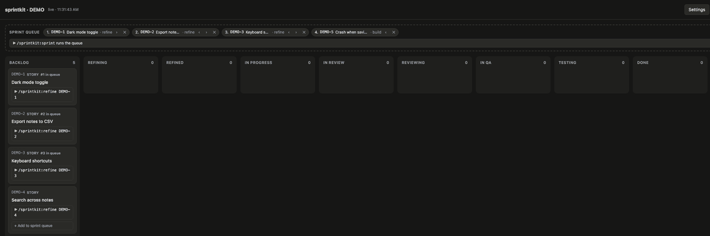

# sprintkit

**Run solo projects the way a real dev team does**: tickets, stages and quality gates, with AI agents doing each stage. A Claude Code plugin.



## Why

Coding agents are fast, and they skip the parts of a team process that catch mistakes: nobody writes acceptance criteria first, nobody reviews the diff, nobody checks each criterion has a test. sprintkit puts that process back without adding a person: every ticket goes through **refine → build → review → QA**, each stage has a gate that has to pass, and work only reaches `main` after QA.

sprintkit owns the **process**. You choose **who** does each stage: the shipped agents, your own agents or skills, a shell command, or yourself.

## How it works

```
backlog ─refine─▶ refined ─build─▶ in-review ─review─▶ in-qa ─qa─▶ done ─release─▶ released
                     ▲                  │                 │
                     └──── changes ─────┴───── fails ─────┘   (back to build with the notes)
```

- **Tickets are markdown files** in `.team/tickets/`, and each stage writes only its own section (Technical notes, Implementation notes, Review notes, QA notes). The Log records every transition.
- **Bookkeeping costs zero tokens.** Status changes, branches, gates, merges, tags and the board are a single Python script (`scripts/team.py`, standard library only). Tokens are spent only where thinking happens.
- **Gates decide, not the agent.** Build needs a commit with the ticket ID and a clean tree; review needs `VERDICT: approve`; QA needs every acceptance criterion ticked plus your test command. QA passing merges the branch.
- **Sprint autopilot**: queue tickets on the board, run `/sprintkit:sprint`, watch the cards move. Tickets that keep failing get blocked instead of looping.
- **Releases and retros**: `/sprintkit:release` smoke-tests `main`, writes the changelog, runs your deploy command and tags the version. `/sprintkit:retro` counts bounce-backs and gate failures from the Logs and proposes one concrete process change.

## Install

In Claude Code (app or terminal):

```
/plugin marketplace add Haberhau/sprintkit
/plugin install sprintkit@sprintkit
```

From a local clone: `claude plugin marketplace add /path/to/sprintkit` and `claude plugin install sprintkit@sprintkit`, then restart Claude Code.

## Quick start

```
/sprintkit:init                                  set up the project (opens the setup screen)
/sprintkit:ticket story Users can switch to dark mode
/sprintkit:board                                 live board in the browser
/sprintkit:sprint                                run the queue on autopilot
```

Or one stage at a time: `/sprintkit:refine APP-1`, `/sprintkit:build APP-1`, `/sprintkit:review APP-1`, `/sprintkit:qa APP-1`.

Details: [plugin README](sprintkit/README.md) (setup, board, gates, config) and the [stage contract](docs/stage-contract.md) (what every stage must produce, and what any custom executor can rely on).

## Development

```bash
python3 sprintkit/scripts/test_team.py
```

sprintkit tracks its own backlog with sprintkit, in [`.team/tickets/`](.team/tickets).
